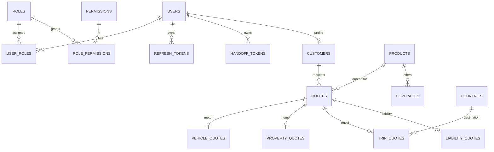

# 08 — Database Architecture

Repository: `ILDB`. Database: `ILPortal` on PostgreSQL 16 (created by `00_create_database.sql`; extensions `pgcrypto`, `uuid-ossp`, `citext`; timezone UTC). Every script is idempotent (`IF NOT EXISTS`, `CREATE OR REPLACE`, `ON CONFLICT DO NOTHING`).

## Scripts

| Script | Content |
|---|---|
| `00_create_database.sql` | creates the database if missing (`psql -v dbname=…` + `\gexec`) |
| `01_database.sql` | extensions, `ALTER DATABASE … SET timezone 'UTC'` |
| `02_schema.sql` | 10 schemas |
| `03_tables.sql` | all tables (also upgrades older databases: adds `username`, moves roles) |
| `04_indexes.sql` | indexes |
| `05_functions.sql` | 3 functions |
| `06_seed_data.sql` | products, coverages, countries, roles, permissions, role-permission map (production-safe) |
| `07_views.sql` | `quote.v_quote_summary` |
| `08_demo_users.sql` | **development only** demo users (bcrypt via pgcrypto) |
| `run_all.ps1` / `run_all.sh` | run `00`–`08`; `ILPORTAL_ENV=Production` skips `08`; `ILPORTAL_DB` overrides the name; needs `PGPASSWORD` |
| `load_data.ps1` + `data/0*.sql` | load an export of the current data (see below) |

## Schemas and tables (actual)

| Schema | Tables | Purpose |
|---|---|---|
| `auth` | `users`, `roles`, `permissions`, `user_roles`, `role_permissions`, `refresh_tokens`, `handoff_tokens` | identity, RBAC, token hashes |
| `customer` | `customers` | customer profile (1:1 with a user via `user_id`) |
| `product` | `products`, `coverages` | catalogue, base rates, coverage loadings |
| `common` | `countries` | travel destinations with risk factor |
| `quote` | `quotes` (+ sequence `quote_number_seq`) | quote header: number, status, premiums |
| `motor` | `vehicle_quotes` | Motor details |
| `home` | `property_quotes` | Home details |
| `travel` | `trip_quotes` | Travel details |
| `liability` | `liability_quotes` | Liability details |
| `audit` | `audit_log` | created but **not written to by any code yet** |

### Key columns

| Table | Columns |
|---|---|
| `auth.users` | `id uuid`, `email citext`, `username citext` (unique), `password_hash`, `full_name`, `is_active`, `created_at` |
| `quote.quotes` | `id`, `quote_number` (unique, e.g. `IL-2026-001001`), `customer_id`, `product_id`, `status` (`draft/quoted/accepted/expired/cancelled`), `base_premium`, `tax`, `total_premium`, `created_at`, `expires_at` (+30 days) |
| `motor.vehicle_quotes` | `quote_id`, `make`, `model`, `year`, `vehicle_value`, `driver_age`, `claims_last_5_years`, `coverage_code` |
| `home.property_quotes` | `quote_id`, `property_type`, `postcode`, `year_built`, `rebuild_value`, `contents_value` |
| `travel.trip_quotes` | `quote_id`, `destination_code` → `common.countries`, `start_date`, `end_date`, `travellers (>0)`, `trip_cost` |
| `liability.liability_quotes` | `quote_id`, `business_type`, `annual_turnover`, `employees`, `limit_amount` |

## Relationships



## Indexes (non-primary-key)

`auth.ux_users_username` (unique), `auth.ix_refresh_user`, `customer.ix_customer_email`, `quote.ix_quotes_customer (customer_id, created_at DESC)`, `quote.ix_quotes_product`, `audit.ix_audit_created`.

## Functions and view

| Object | Used by | Purpose |
|---|---|---|
| `product.fn_active_products()` | `GET /api/products` | active product list |
| `quote.fn_next_quote_number()` | quote insert | `IL-<year>-<6-digit sequence>` |
| `quote.fn_expire_quotes()` | nothing yet | marks overdue `quoted` rows `expired` (to be scheduled) |
| `quote.v_quote_summary` (view) | quote reads, reports | quote + product + customer columns |

**There are no PostgreSQL functions that return JSON/JSONB and no stored procedure for quote creation.** Premium calculation is in C# (`PremiumCalculator`); the API issues parameterised SQL through Dapper in `Repositories.cs`.

## Data path

```text
Flutter / Angular → ILAPI controller → repository (Dapper, Npgsql) → table / view / function
```

## Seed data (verified)

| Item | Values |
|---|---|
| Products (`base_rate`) | MOTOR 0.0350, HOME 0.0012, TRAVEL 0.0400, LIABILITY 0.0025 |
| Coverages | MOTOR `COMPREHENSIVE` 0 %, `THIRD_PARTY` −30 % |
| Countries (risk factor) | GB 1.00, FR 1.10, DE 1.10, ES 1.15, JP 1.30, IN 1.60, AU 1.80, US 2.50 |
| Roles | ADMIN, AGENT, UNDERWRITER, MANAGER, CUSTOMER |
| Permissions | 14 (see [10](10_Role_Based_Access.md)) |

The rates, loadings and risk factors are placeholders chosen for development, not approved underwriting data.

## Data export / restore

`ILDB/data/01…06_*.sql` are `pg_dump --column-inserts --on-conflict-do-nothing` exports of the data at 2026-10-07 (countries, products, RBAC, customers, quotes). `04_auth_users.sql` (password hashes) is git-ignored and local only. Restore: run `run_all.ps1` (with `ILPORTAL_ENV=Production`), then `load_data.ps1`. Verified by loading into an empty scratch database and comparing row counts. Token tables and `audit_log` are not exported.

## Security

The `postgres` superuser is used in development. A production deployment should use a least-privilege application role; this is not yet scripted.
