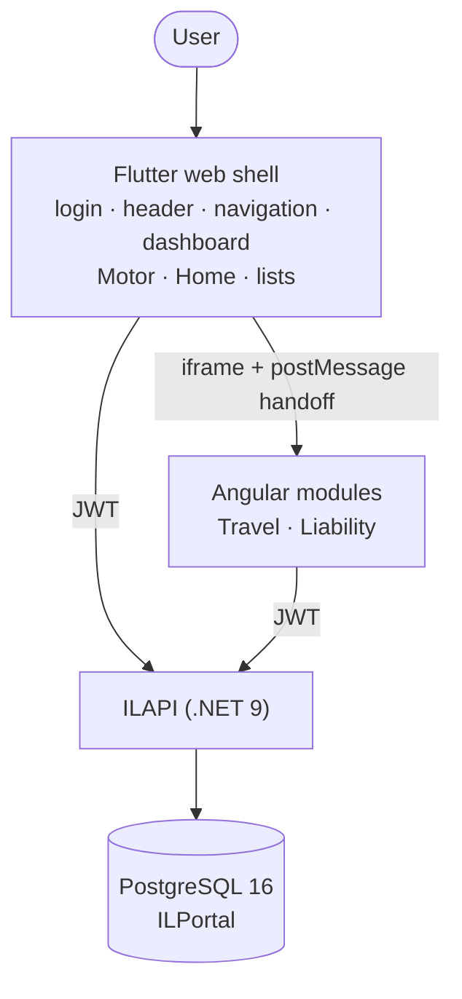

# IL Insurance Portal — Documentation

```text
Project Status:         Working development system; not deployed; no GitHub remotes yet
Architecture:           Flutter web shell + Angular modules (iframe) + one .NET API + one PostgreSQL DB — IMPLEMENTED
Flutter Status:         IMPLEMENTED — login, header/top navigation, dashboard, Motor, Home, list pages, role menus, go_router, Angular host
Angular Status:         IMPLEMENTED — Travel and Liability modules only (no login/header/dashboard), guards, handoff
API Status:             IMPLEMENTED — v1 auth, JWT + permission policies, quotes, admin read endpoints, health check
Database Status:        IMPLEMENTED — 10 schemas, 17 tables, 3 functions, 1 view, seed data, demo users, data export/loader
Integration Status:     IMPLEMENTED — iframe + postMessage one-time-token handoff; verified in a real browser for all 5 roles
Authentication Status:  IMPLEMENTED — central login, refresh, logout; PARTIAL — Angular refresh token not revoked on logout (known gap)
Quote Status:           IMPLEMENTED — 4 products, single-step forms; PLANNED — multi-step flows, customer selection, approved rates
Testing Status:         PARTIAL — 10 + 12 + 5 unit tests, 82-check API role script, browser e2e; no API integration tests, no CI
Deployment Status:      PLANNED — no Docker/CI; Angular environment config still hard-coded
```

Verified against the source and running system on 2026-10-07. Where something is not built, the documents say **PLANNED**.

## Architecture at a glance



## Index

| # | Document | What it covers |
|---|---|---|
| 01 | [Project Overview](01_Project_Overview.md) | the five folders, responsibilities, why two front-end technologies |
| 02 | [Architecture](02_Architecture.md) | layers, decisions, implemented vs planned |
| 03 | [Flutter + Angular Integration](03_Flutter_Angular_Integration.md) | the actual iframe/postMessage mechanism, files, security notes |
| 04 | [Authentication Flow](04_Authentication_Flow.md) | login, JWT, refresh, handoff, logout, limitations |
| 05 | [Routing and Navigation](05_Routing_and_Navigation.md) | Flutter and Angular routes, history, refresh, logout |
| 06 | [Product Flow](06_Product_Flow.md) | who owns which product, flows, availability by role |
| 07 | [API Integration](07_API_Integration.md) | every endpoint that exists, code map, CORS, secrets |
| 08 | [Database Architecture](08_Database_Architecture.md) | schemas, tables, relations, functions, seed, export |
| 09 | [Quote Generation Flow](09_Quote_Generation_Flow.md) | fields, rules, pipeline per product |
| 10 | [Role-Based Access](10_Role_Based_Access.md) | permission matrix, menus, demo users, enforcement |
| 11 | [Issues and Solutions](11_Issues_and_Solutions.md) | 16 issues with cause, fix, files, result |
| 12 | [Implementation Progress](12_Implementation_Progress.md) | phases, status, commit hashes |
| 13 | [Local Development Setup](13_Local_Development_Setup.md) | prerequisites and run commands |
| 14 | [Build and Deployment](14_Build_and_Deployment.md) | builds, environments, checklist (deployment planned) |
| 15 | [Testing Strategy](15_Testing_Strategy.md) | what is tested, scenarios, gaps |
| 16 | [Troubleshooting](16_Troubleshooting.md) | symptom → cause → verify → fix |
| 17 | [Future Enhancements](17_Future_Enhancements.md) | planned work |

Diagrams (Mermaid): [overall architecture](diagrams/overall-architecture.md) · [authentication](diagrams/authentication-flow.md) · [Flutter + Angular](diagrams/flutter-angular-flow.md) · [routing](diagrams/routing-flow.md) · [quote generation](diagrams/quote-flow.md) · [deployment](diagrams/deployment-flow.md)

## Final architecture rules

1. Flutter is the main portal shell and owns login, dashboard, header, global navigation, profile, logout, Motor and Home.
2. Angular owns Travel and Liability only; it has no global navigation, login, dashboard or logout.
3. Both front ends use the same .NET API, which is the only component that talks to PostgreSQL.
4. Authentication is central (Flutter login); Angular receives a session through the one-time-token handoff.
5. Authorization is enforced by the API; menus and guards only mirror it.
6. The user sees one portal; portal-shell functionality is never duplicated.

## Quick start (details in [13](13_Local_Development_Setup.md))

```powershell
cd ILDB;  $env:PGPASSWORD="<pw>"; ./run_all.ps1
cd ILAPI; dotnet run --project ILAPI.API --urls http://localhost:5080
cd ILWEBAngular; npm install; npm start                       # :4200
cd ILWEBFlutter; flutter run -d chrome --web-port 8090        # :8090  → open this
```

## Conventions and safety

- Paths in these documents are relative to the `ILPortal/` folder. Each of `ILAPI`, `ILDB`, `ILWEBFlutter`, `ILWEBAngular` is its own git repository; `ILDoc` is a plain folder.
- No secrets are documented. Demo credentials (development only) are listed in [10](10_Role_Based_Access.md).
- `ILDoc/00_DB_and_GitHub_Bootstrap_Prompt.md` is the original bootstrap prompt and **contains a local database password**: do not commit or share it.
