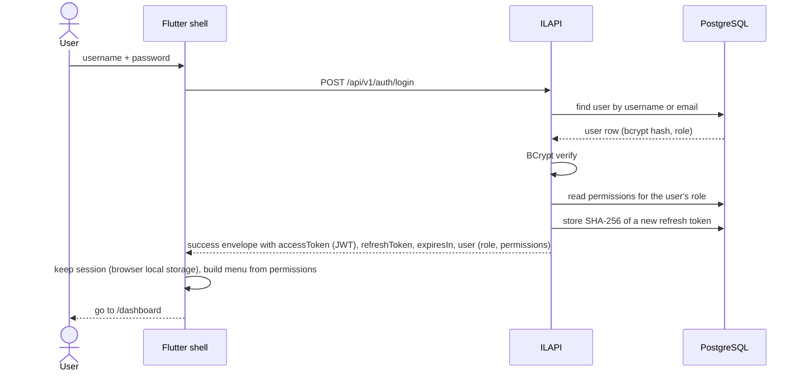
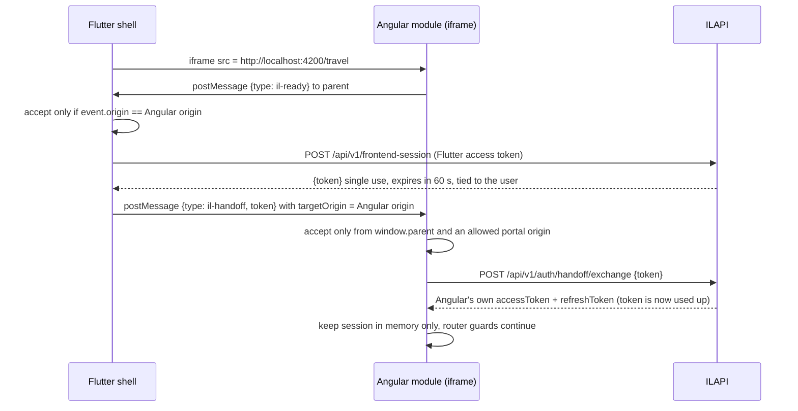
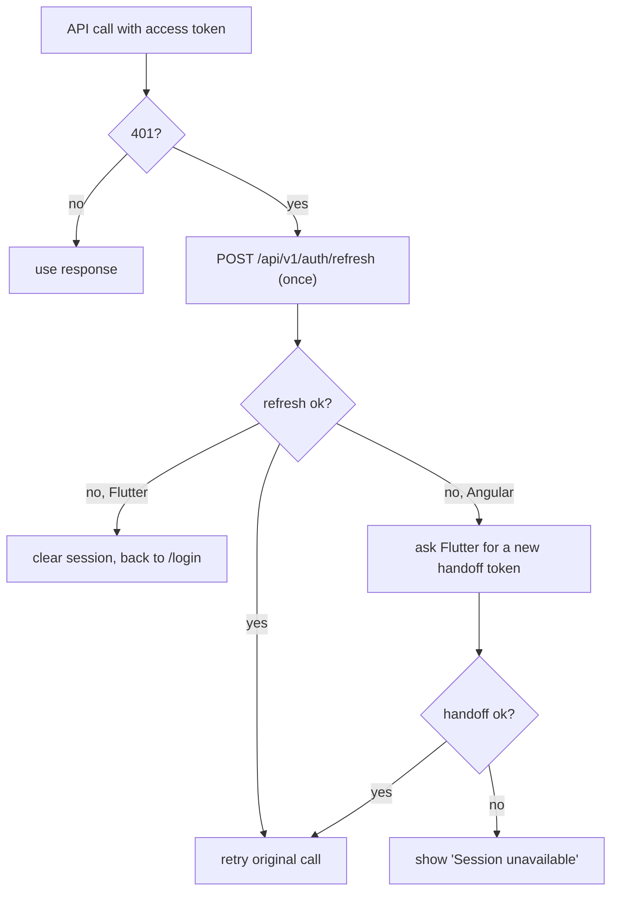
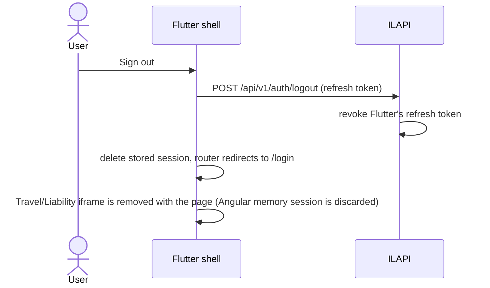

# Authentication Flow

## 1. Login (Flutter only)

## 2. Session handoff to the embedded Angular module (no token in a URL)

## 3. Token refresh and failure

## 4. Logout

Known gap: Angular's own refresh token is not revoked on logout (see `11_Issues_and_Solutions.md`, Issue 7).
