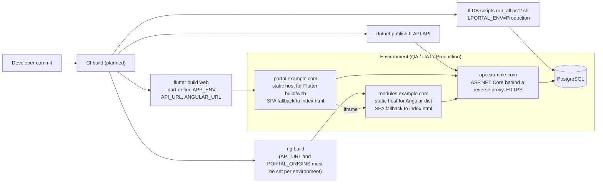

# Deployment Flow

Status: **PLANNED**. The repository has no Dockerfiles, compose file or CI pipeline yet; this diagram shows the recommended target, derived from how the apps are built today (`flutter build web`, `ng build`, `dotnet publish`).

Requirements that follow from the code:

- The API's `Cors:Origins` must list the Flutter origin and the Angular origin.
- Angular's `PORTAL_ORIGINS` (in `ILWEBAngular/src/app/core/config.ts`) must list the Flutter origin, and Flutter's `ANGULAR_URL` must point at the Angular host.
- Both static hosts must return `index.html` for unknown paths (path URLs, no `#`).
- The Angular host must allow being framed by the Flutter origin (no `X-Frame-Options: DENY`; use `Content-Security-Policy: frame-ancestors <flutter origin>`).
