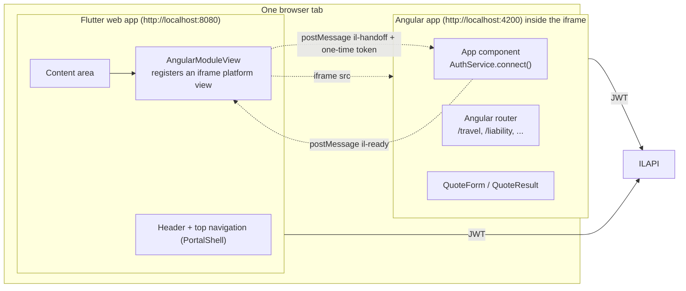
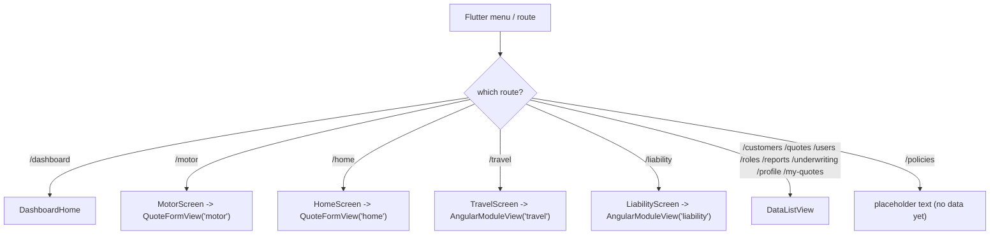

# Flutter + Angular Integration Flow

## What Flutter shows for each menu item

Angular never renders a header, navigation, dashboard, login or logout; it renders only the quote form or result inside the iframe.
