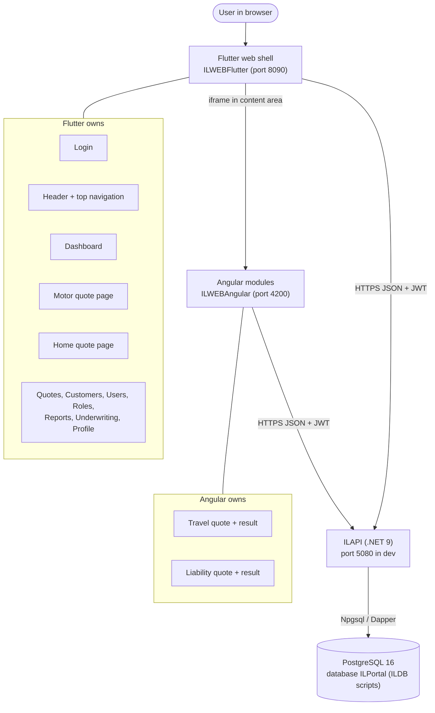

# Overall Architecture

Verified against the code: Flutter is the shell; Angular is loaded into it as an iframe for Travel and Liability only; one API; one PostgreSQL database.

| Box | Repository / folder | Role |
|---|---|---|
| Flutter web shell | `ILWEBFlutter` | login, header, navigation, dashboard, Motor, Home, admin list pages |
| Angular modules | `ILWEBAngular` | Travel and Liability only |
| API | `ILAPI` | authentication, authorization, premium calculation, persistence |
| Database | `ILDB` | schema, seed data, demo users, data export scripts |
| Documentation | `ILDoc` | this documentation |

Neither front end connects to PostgreSQL directly.
