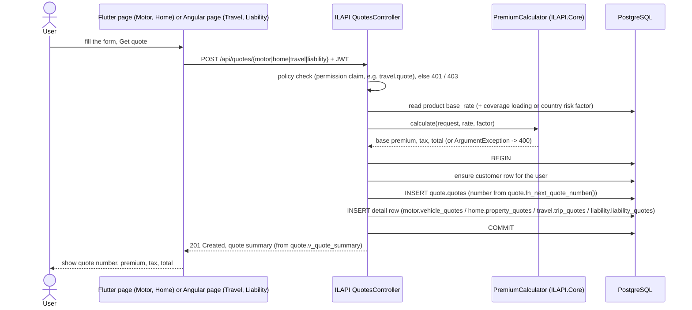
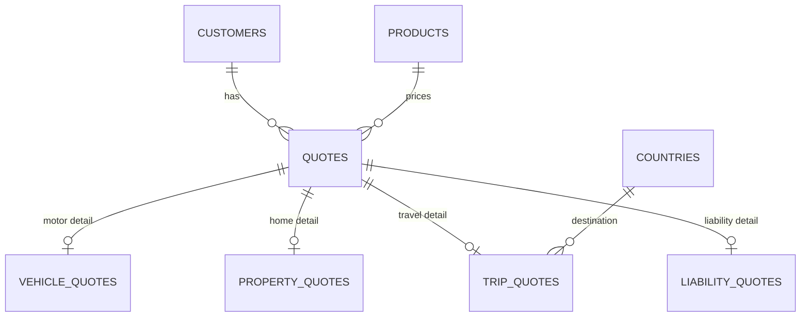

# Quote Generation Flow

All four products use the same API pattern. Premium rules are computed in C# (`PremiumCalculator`), rates and loadings are read from PostgreSQL, and the quote is saved in one transaction.

